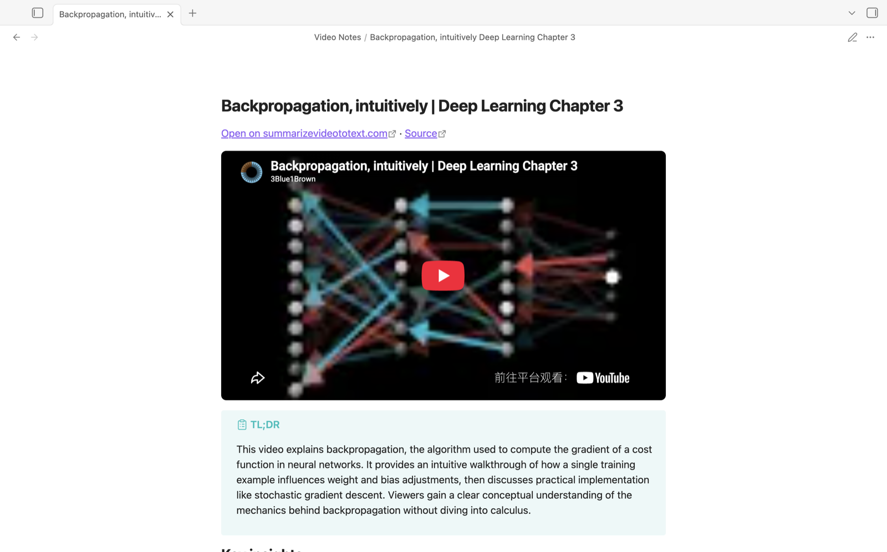
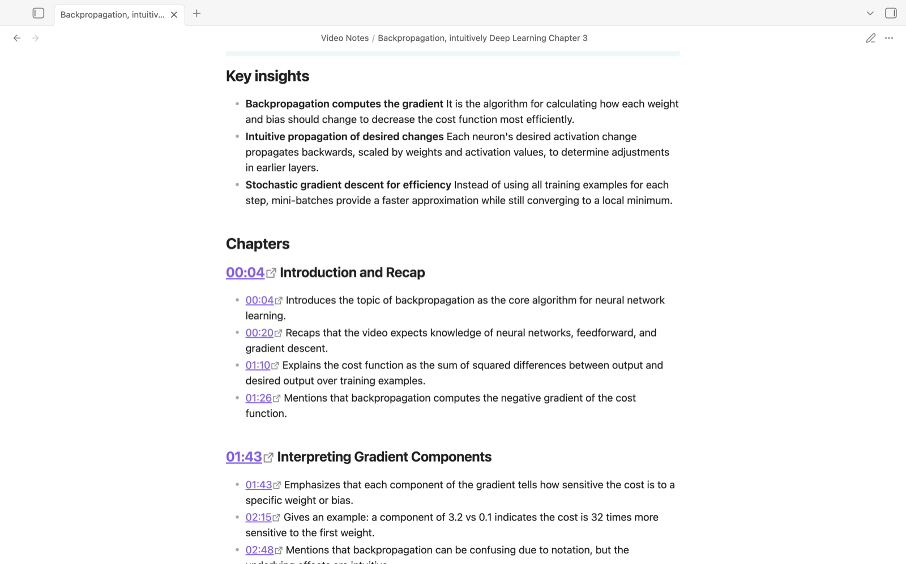
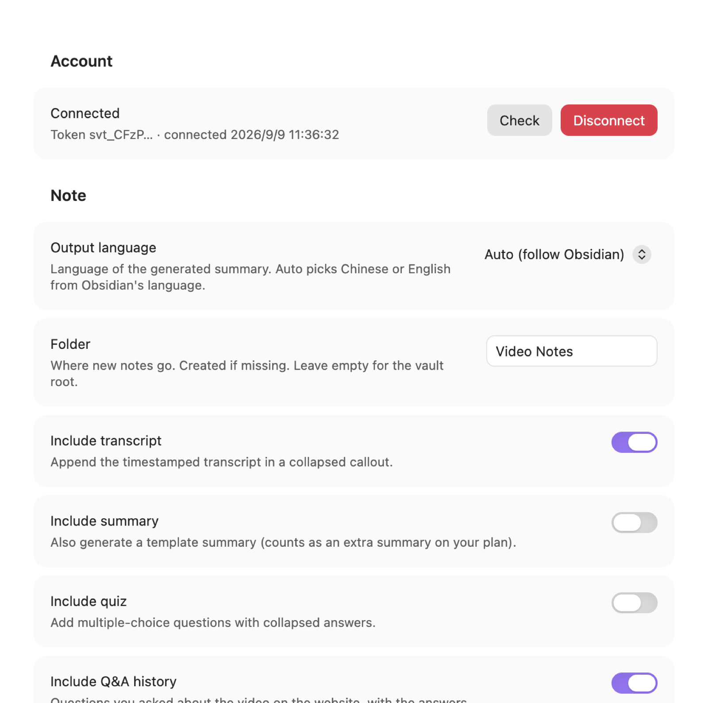
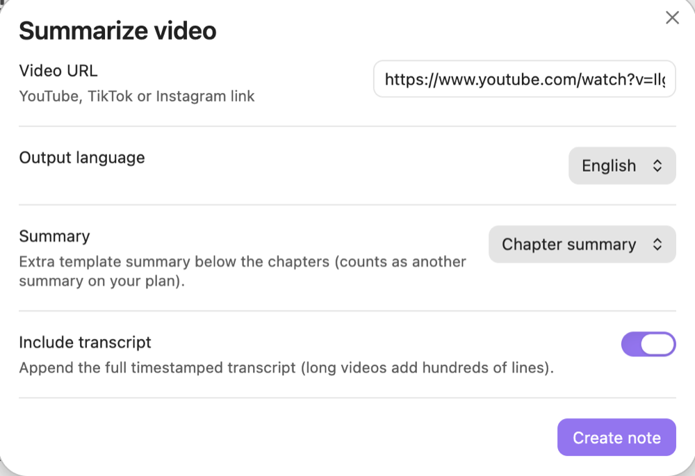
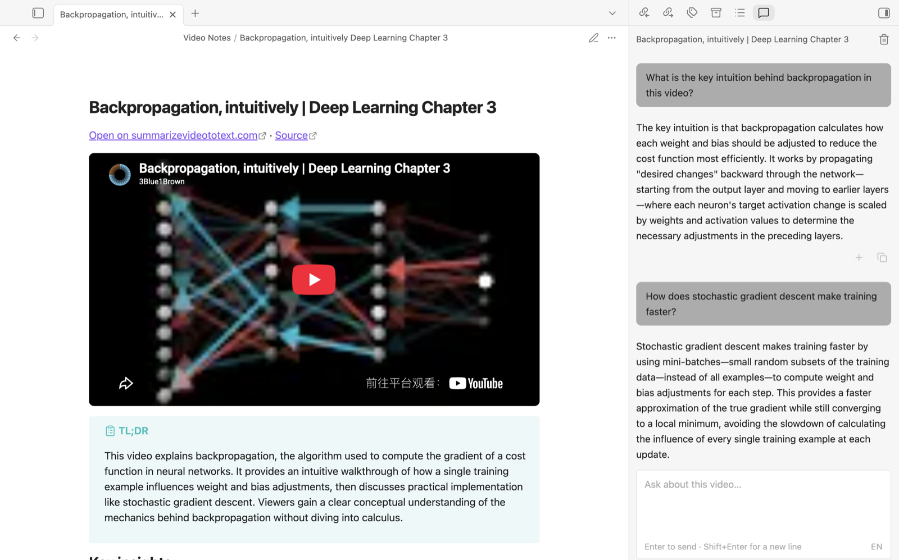
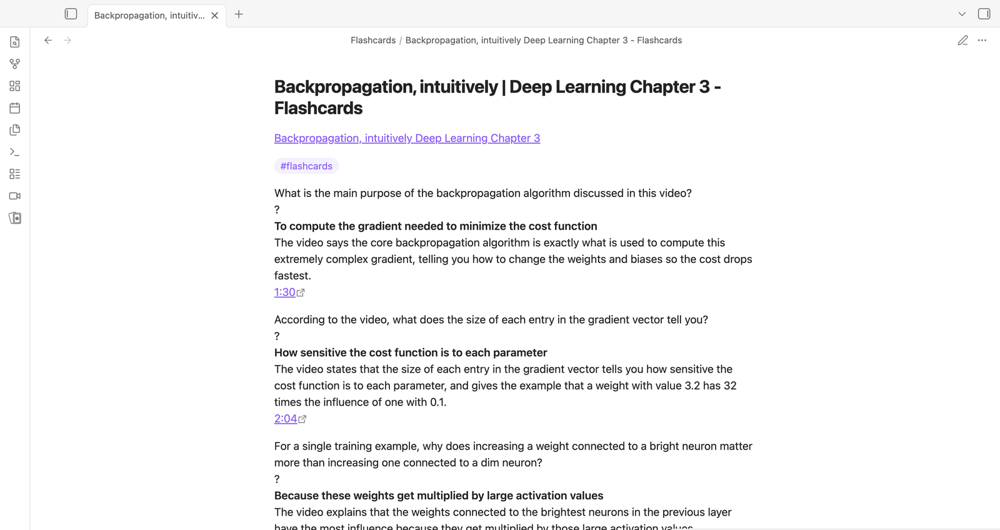

# Summarize Video To Text — Obsidian plugin

Turn a YouTube, TikTok or Instagram video into a structured Obsidian note in one command:



**Video walkthrough:** [Obsidian Plugin: Video Notes with TL;DR, Chapters & Flashcards](https://www.youtube.com/watch?v=gLg68gFJ36E)

[](https://www.youtube.com/watch?v=gLg68gFJ36E)

- **TL;DR** callout and **key insights**
- **Embedded player** (YouTube and TikTok) at the top of the note; timestamp links seek it in place
- **Chapters** with timestamped bullet points (with the player off, a timestamp opens the video's page on summarizevideototext.com at that second)
- Optional **summary** included with video processing (custom templates are currently unavailable)
- Optional **quiz** with collapsed answers — and one command turns it into **spaced-repetition flashcards**
- Optional **transcript** in a collapsed callout
- A link back to the video's page on summarizevideototext.com (player, Q&A, quiz, progress) plus the original source link
- Frontmatter with title, source, workspace link, channel, language and tags — ready for Dataview



Everything is generated by [summarizevideototext.com](https://summarizevideototext.com); the note Markdown itself comes from the site's export endpoint, so the website's *Export → Obsidian* button and this plugin produce the same note. The plugin stores no model keys and sends nothing but the video link and your account token to that service.

## Before you install

- **Account required.** Connect the same summarizevideototext.com account you use on the website. The plugin and website share one credits balance. A one-time trial grants 20 credits; subscriptions and one-off purchases add credits ([pricing](https://summarizevideototext.com/pricing)). Quizzes remain a Pro feature.
- **Network use.** Every command sends the video link, your output-language choice and your account token to `https://summarizevideototext.com` (or the server URL you set). The video is fetched and analysed there; nothing is processed locally and no other service is contacted. See the site's [privacy policy](https://summarizevideototext.com/privacy) and [terms](https://summarizevideototext.com/terms).
- **No telemetry.** The plugin itself collects nothing; the server keeps ordinary request logs for the calls above.

## Setup

1. Install the plugin and enable it.
2. Open **Settings → Summarize Video To Text** and click **Connect**. Your browser opens the website; sign in (Google, or create a free account) and it will send you back to Obsidian.
3. If the browser can't open Obsidian, copy the token shown on the website and paste it into the **Or paste a token** field.



Creating a note automatically quotes and charges the video: existing subtitles cost 1 credit/minute and AI transcription costs 10 credits/minute, rounded up with a 10-credit minimum per video. Processing includes the analysis and summary. Reopening your completed result and exporting it again do not charge another video. Insufficient credits stop processing and provide a link to buy credits; use the same account and retry. Homepage reference videos are free to view and export. See the [pricing page](https://summarizevideototext.com/pricing).

## Usage

- **Command palette → Summarize video from URL**: paste a link (the clipboard is pre-filled if it holds a link). Choose the output language and whether to include the summary and transcript in this note.

  

- **Right-click a link** in the editor or in reading view → **Summarize video**.
- **Select a link in a note → Summarize video link in selection** (no dialog, uses your settings).
- Or click the video icon in the ribbon.
- **From the website**: on any video page, *Export → Obsidian* sends the note straight into this plugin (no re-analysis).
- **Open video chat**: a right-sidebar panel to ask questions about the note you're reading. It uses the note's generated section as context, keeps the conversation per video (same history as the website's Q&A tab), and **Add to note** appends an answer under your own notes.

  

- **Refresh video note**: re-fetch the generated part of the current note (new quiz results, Q&A, progress). Everything outside the `%% svt:start %%` / `%% svt:end %%` markers, and any frontmatter keys you added, is kept.
- **Create flashcards from video note** (also on the note's right-click menu): turn the video's quiz into a separate note of cards for the [Spaced Repetition](https://github.com/st3v3nmw/obsidian-spaced-repetition) plugin — multi-line format, the correct option and its explanation on the back, and a timestamp link to the moment the question came from. Run it again after new questions appear and only the missing cards are appended: existing cards, their review schedule (`<!--SR:…-->`) and any cards you wrote yourself are never touched.
  Ticking **Also make flashcards** in the *Summarize video* dialog does the same thing while the note is created, so both notes land in one go.
  Cards come from the quiz, which is a **Pro** feature: if the video already has one, building the cards costs nothing extra; if it doesn't, a quiz is generated then and counts against your plan. The video note is written first either way.

  

Chat requires a video processed by the same account and follows the same finite daily limits as the website. Notes created before unified credits may need the video to be processed under the current account first.

Notes are created in the folder you choose (default `Video Notes`) and opened automatically.

## Settings

| Setting | What it does |
| --- | --- |
| Output language | Language of the summary. *Auto* follows Obsidian's language (Chinese or English). |
| Folder | Destination folder, created if missing. |
| Include transcript | Append the timestamped transcript (collapsed). |
| Include summary | Include the default summary already covered by video processing. No extra video charge. |
| Include quiz | Add multiple-choice questions with collapsed answers (Pro). |
| Include Q&A history | Add the questions you asked about the video on the website. |
| Embed video player | YouTube and TikTok: put a `svt-video` block (rendered as a player) at the top instead of the thumbnail. Clicking a timestamp seeks the player. With the player off, YouTube timestamps open the browser at that second; TikTok links open the video from the start (TikTok has no seek parameter). Instagram and uploads keep the thumbnail. |
| Open note after creating | Self-explanatory. |
| Make flashcards with every new note | Default for the *Also make flashcards* toggle in the dialog. A video with no quiz yet gets one generated, which counts against your plan (Pro). |
| Flashcards folder | Where *Create flashcards from video note* puts the card notes (default `Flashcards`). |
| Deck tag | Tag written at the top of a card note; the Spaced Repetition plugin uses it as the deck. A nested tag such as `#flashcards/videos` becomes a sub-deck. |
| Server URL | Advanced. Only change to test a preview deployment. |
| Preview bypass secret | Advanced. Vercel *Protection Bypass for Automation* secret, only needed for a protected preview server. |

## Privacy and network use

- The plugin talks only to the server URL in settings (default `https://summarizevideototext.com`).
- It sends the video link, your chosen language and your account token. Video content is fetched and processed server-side.
- **Clipboard access.** When you open the video URL dialog without a selected link, the plugin reads the clipboard once to pre-fill the first HTTP(S) link it finds. It does not monitor the clipboard in the background or submit the clipboard text automatically; processing starts only after you click **Create note** or press Enter in the URL field. Clicking **Copy** on a chat answer writes that answer to the clipboard. Clipboard access may appear as a disclosure in the community scorecard.
- Your token is stored in this vault's `.obsidian/plugins/summarize-video-to-text/data.json`. If you sync or share the vault, treat that file as a secret; you can revoke tokens any time at **summarizevideototext.com/connect/obsidian**.

## Development

See [CONTRIBUTING.md](CONTRIBUTING.md) for issue reporting and contribution guidelines.

```bash
npm install
npm run dev          # watch build → main.js (debug channel)
npm run build:debug  # one-off debug build
npm test             # vitest: note merging, player helpers, SSE parsing
npm run build        # release: typecheck + minified main.js
```

Build channels: `dev` and `build:debug` produce a **debug** build whose default server is the preview site `https://pre.summarizevideototext.com`; `build` produces the **release** build pointing at `https://summarizevideototext.com`. The channel and default are shown under *Settings → Advanced*. The preview site sits behind Vercel Deployment Protection, so a debug build also needs the *Preview bypass secret* setting (never commit it).

Copy `main.js`, `manifest.json` and `styles.css` into `<vault>/.obsidian/plugins/summarize-video-to-text/` to test locally.

The website's connect page lives at `/connect/obsidian` and returns to Obsidian via the `obsidian://svt-connect?token=…&state=…` protocol. The `state` is generated by the plugin and checked on return, so a stray link can't inject a token.

## License

MIT
